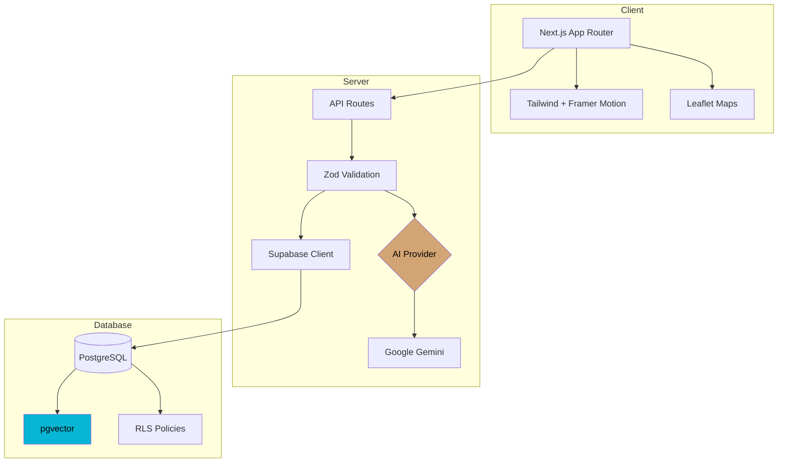

# DarFinder AI

> AI-powered property assistant for the Dubai real estate market

A full-stack portfolio project demonstrating **natural language search**, **AI content generation**, **hybrid vector ranking**, and a **luxury dark-first UI** — built with Next.js, Supabase, Google Gemini, and pgvector.

## Architecture



## Key Features

### Public Users
- **Natural language search** — "2BR near metro in JVC under 90k" parsed by Gemini into structured filters
- **Hybrid ranking** — traditional filters + pgvector semantic similarity re-ranking
- **Property comparison** — side-by-side table with AI-generated pros/cons summary
- **Enquiry system** — contact agents directly from property pages
- **Map view** — Leaflet/OSM with price markers across 10 Dubai areas
- **Bilingual** — English + Arabic descriptions with RTL support

### Agents (Authenticated)
- **AI listing writer** — generates title, EN/AR descriptions, and highlights from property details
- **Lead management** — pipeline tracking (new → contacted → viewing → closed)
- **AI follow-up drafts** — WhatsApp-style messages generated from lead context
- **Dashboard** — animated stats, lead pipeline, search analytics, zero-result opportunities

## Tech Stack

| Layer | Technology |
|-------|-----------|
| Framework | Next.js 16 (App Router, Turbopack) |
| Language | TypeScript (strict) |
| Styling | Tailwind CSS v4, Framer Motion |
| Components | shadcn/ui (base-nova style) |
| Database | Supabase (PostgreSQL + pgvector + Auth + RLS) |
| AI | Google Gemini (text + embeddings) |
| Validation | Zod (inputs + AI outputs) |
| Maps | Leaflet + OpenStreetMap |
| Testing | Vitest (33 tests) |

## Security Design

### AI Never Writes SQL

The AI returns a **JSON filter object only**. The server validates it with Zod, then builds database queries using Supabase's query builder (`.eq()`, `.gte()`, `.in()`, etc.). No raw SQL from AI ever reaches the database.

```
User query → Gemini (JSON output) → Zod validation → Query builder → Supabase
```

If Gemini returns invalid JSON:
1. Retry once with the Zod error appended to the prompt
2. Fall back to keyword search (text match on title + description + area)

### Row Level Security

- Public users can **read** only `status = 'active'` properties
- Agents can **edit** only their own properties
- Agents can **see** only their own leads
- Service client (server-side) bypasses RLS for cross-cutting operations (enquiry → lead creation)

### Rate Limiting

- In-memory sliding window: **30 searches per IP per hour**
- IP hashed with SHA-256 (no personal data stored)
- Search logs capture filters only, never personal data

## Local Setup

### Prerequisites

- Node.js 18+
- Supabase project (free tier works)
- Google AI Studio API key (Gemini)

### 1. Clone and install

```bash
git clone <repo-url>
cd darfinder
npm install
```

### 2. Environment variables

```bash
cp .env.example .env.local
```

Fill in your Supabase and Gemini credentials:

```
NEXT_PUBLIC_SUPABASE_URL=https://your-project.supabase.co
NEXT_PUBLIC_SUPABASE_ANON_KEY=your-anon-key
SUPABASE_SERVICE_ROLE_KEY=your-service-role-key
GEMINI_API_KEY=your-gemini-api-key
```

### 3. Run migrations

Apply all SQL migrations in order from `supabase/migrations/` in your Supabase SQL editor.

### 4. Seed data

```bash
npm run seed
```

Creates 80 fictional properties across 10 Dubai areas + a demo agent account.

### 5. Generate embeddings

```bash
npm run embeddings
```

Generates 768-dimension vectors for all properties using Gemini's embedding model.

### 6. Start dev server

```bash
npm run dev
```

Open [http://localhost:3000](http://localhost:3000).

## Project Structure

```
src/
├── app/                    # Next.js App Router pages + API routes
│   ├── api/
│   │   ├── search/         # AI-powered search endpoint
│   │   ├── compare/        # AI property comparison
│   │   ├── properties/     # CRUD with Zod validation
│   │   ├── enquiry/        # Public enquiry → lead creation
│   │   ├── leads/          # Agent lead management (RLS)
│   │   ├── ai/             # AI listing writer + follow-up
│   │   └── agent/          # Dashboard aggregation
│   ├── properties/         # Public browsing pages
│   ├── compare/            # Side-by-side comparison
│   ├── agent/              # Authenticated agent pages
│   └── auth/               # Login + callback
├── components/
│   ├── ui/                 # shadcn primitives
│   ├── layout/             # Header, Footer, MobileNav
│   ├── search/             # SearchBar, FilterChips, Results
│   ├── property/           # Card, Gallery, Details, Map, Enquiry
│   ├── compare/            # Selector, Table
│   ├── agent/              # ListingForm, AIWriter, Leads, Dashboard
│   └── map/                # Leaflet multi-property map
├── lib/
│   ├── ai/                 # Provider interface, Gemini, prompts, schemas
│   ├── supabase/           # Client, server, middleware, types
│   ├── validators/         # Zod schemas for all inputs
│   ├── queries/            # Query builders
│   ├── rate-limit.ts       # Sliding window rate limiter
│   └── utils.ts            # Format helpers
├── hooks/                  # React hooks (compare, search)
├── types/                  # Shared TypeScript types
└── __tests__/              # Vitest test suite
```

## Testing

```bash
npx vitest run
```

**33 tests** across 5 files:
- AI filter parser schema validation (8 tests)
- Query builder filter → Supabase mapping (5 tests)
- Rate limiter sliding window behavior (4 tests)
- Property creation validator (10 tests)
- Enquiry form validator (6 tests)

## Build Phases

| Phase | Description | Commit |
|-------|-------------|--------|
| 1 | Foundation — scaffold, DB, auth, seed, luxury theme | ✅ |
| 2 | Property browsing — list, detail, map, filters | ✅ |
| 3 | AI search — Gemini + pgvector hybrid ranking | ✅ |
| 4 | Compare, enquiry, leads management | ✅ |
| 5 | AI listing writer with multi-step form | ✅ |
| 6 | Dashboard, search analytics, expanded tests | ✅ |
| 7 | Documentation + deploy config | ✅ |

## Deploy

Optimized for **Vercel**:

```bash
vercel deploy
```

Set environment variables in Vercel project settings. The app uses Edge-compatible APIs and no native Node.js modules.

## License

MIT
